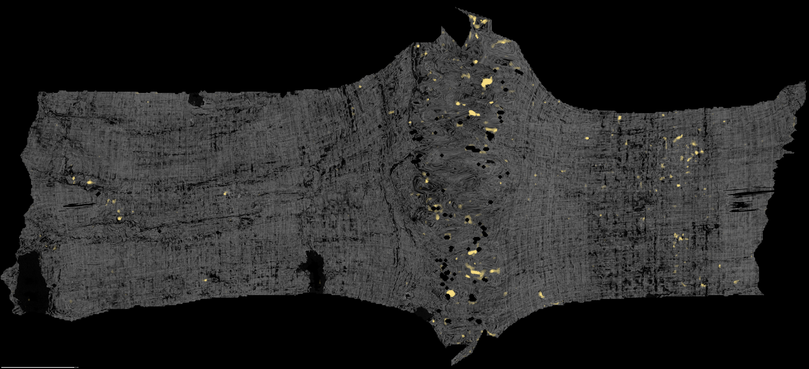
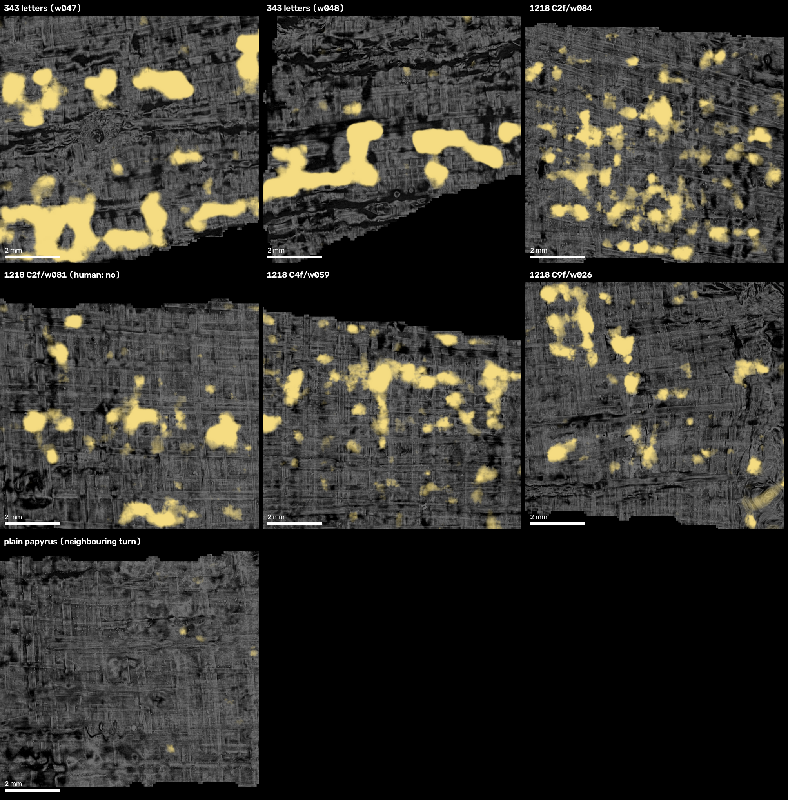

# First Light — PHerc. 1218

I ran the chain that produced PHerc. 343's first letters on PHerc. 1218, which came from the same ESRF session and protocol.
I refit the meshes, screened with three ink models under rules committed in advance, judged every flagged
spot by eye, and re-checked the strongest areas with a six-model depth sweep. Overall, I did not identify any true letters, though my analysis is discussed below.

## What was covered

- Slices 1,380-20,960 of 23,247, windings 10 to 129.
  - Main pass: 3,095 cm² in 511 turns, every turn with at least 70% of its surface on the predicted papyrus sheet.
  - Exploratory pass: 4,788 cm² in 615 other turns, at 60-70% on the sheet, reported separately.
  - The two passes do not overlap: together they screened 7,883 cm² in 1,126 turns.
- By band, what was not covered, how to read labels like `C3f/w049`, and how to find any spot:
  [`COVERAGE.md`](COVERAGE.md).

## Data

New meshes across most of PHerc. 1218 (slices 1,380-20,960, windings 10-129), fitted to the papyrus and ready to
render, plus every screening result. This was done due to low fit on papyrus of previously existing meshes.

**On Hugging Face:** [Jake-Vc/first-light-pherc1218](https://huggingface.co/datasets/Jake-Vc/first-light-pherc1218) (~9 GB):
- `flat/`: the flattened, snapped meshes (tifxyz) per window, the surfaces I rendered and screened. Render them
  against the public volume `20250521120456-8.640um-1.2m-116keV-masked` with VC3D `vc_render_tifxyz`.
- `seg_big/`: three large segments from an independent villa-main fit, with ink maps and the candidate boxes located in them.
- `screen/`: per-window flag statistics, contact sheets, review and depth-sweep panels.
- `fits/`: fit logs and on-sheet reports; `candidates/`: per-candidate images; `pipeline_logs/`: job logs as run.
- `MANIFEST.tsv`: size and sha256 of every file.

Not included, because they can be re-created: the public CT and lasagna inputs, the 66-layer renders, fit checkpoints.

**In this repo:** every image of the ink-like spots and the 343 control ([`renders/`](renders/INDEX.md)), verdicts
and measurements ([`analysis/`](analysis/)), the readout rules ([`prereg/`](prereg/readout.md)), the decision log
([`logs/`](logs/)) and every script that produced a result ([`runbook/`](runbook/README.md)).

**Finding a spot:** see [`COVERAGE.md`](COVERAGE.md#finding-a-spot).

## First look

One whole winding (2.6 cm tall), flattened, with the winner's four ink models averaged in yellow over the dimmed CT.
Most yellow sits in a distorted band through the middle, where the mesh is stretched; the papyrus around it shows
scattered small marks. The readout rules I fixed before looking are in [`prereg/readout.md`](prereg/readout.md).

## What broke on the way

- **The public 1218 meshes sit between the layers:** only 16% (median) of their surface lies within ±2 voxels of the
  predicted sheet, against 71-75% for the winner's 343 meshes.
  - Fix: I built new meshes with the winner's fitting chain (surf-SDT spacing, tracks, normals). Median share on the
    sheet per window: 67-71% in band C; 51-64% in bands D and E, which is why most of their turns only reached the
    exploratory pass.

Three more, each now a villa PR with the real measurement and the fix:
- **A headless fit writing to a log file shows no loss until it ends.**
  - Fix: [ScrollPrize/villa#2289](https://github.com/ScrollPrize/villa/pull/2289) flushes the loss report every 200
    iterations, so a long fit can be watched (and stopped) while it runs.
- **The command-line renderer ignores the cache size limit and filled my pod disks** (50 GB in about 2.5 hours).
  - Fix: [ScrollPrize/villa#2290](https://github.com/ScrollPrize/villa/pull/2290) applies the same VC3D.ini cache
    budget as the app.
- **The number of fit steps is a guess per window;** too many wastes GPU time.
  - Fix: [ScrollPrize/villa#2323](https://github.com/ScrollPrize/villa/pull/2323) stops a fit once its loss levels off (lasagna's `steps: "auto"` rule): on PHerc. 343, 8,400 instead of 10,000 iterations, 14% less fit time, same placement.

## What we see

> Despite some of the models flagging ink areas throughout, after manual review and additional depth checks, none of
> the areas appear to truly contain usable ink.

- **Control first:** the same render and ink stack reads PHerc. 343's published letters (held out from every model).
- **Screen:** every flattened turn with >= 70% of its surface on the papyrus, 3,095 cm² in 511 turns, preregistered;
  plus 4,788 cm² in 615 turns at 60-70%, exploratory. 468 turns flagged (2 of 3 models above the 343-calibrated level).
- **Judged by eye:** all 557 flagged turns across every pass: 0 letters, 23 possible letter, 48 ink-like without
  letters, 2 unsure, 484 not ink.
- **Detail review:** 29 boxes re-rendered at full resolution with both neighbouring turns, six models, depths -8..+8.
- **Depth sweep (-15..+15, six models):** the five strongest. Their marks sit on the surface over 6-13 consecutive
  depths, as surface ink would, but none is legible, and the 1218 marks are blobs at most 1.6 mm tall, against
  2.2-2.6 mm connected strokes for 343's letters measured the same way.

### Is the result real?

| Check | Result |
|---|---|
| Scale | Grid spacing at the candidates 19.5-19.8 voxels against the declared 20: nothing stretched there. |
| Control | The same size measurement finds 343's letters at 2.2-2.6 mm; no 1218 candidate exceeds 1.6 mm. |
| Placement | Every screened turn >= 70% on the predicted sheet; CT cross-sections at each candidate in `renders/`. |
| Neighbouring sheets | The least-yellow neighbouring tile: 0.2% yellow, against 7-12% at the candidates and 10-19% at 343's letters. |
| Independent segmentation | Three candidates located in large segments of a separate fit: C2f/w081 shows no row of marks at any depth (full sweep), C2f/w084 only scattered unreadable marks, C4f/w059 almost no yellow. |

Deviations from the readout rules, each decided by the human before the results it affected:
- scope lowered from 80% to 70% on the sheet, after the winner's own 343 meshes scored 71-75%;
- screen models changed to reader-v3, dense_native and reader-v2 with a 2-of-3 rule, after the 343 control;
- every winding flattened before rendering, as the 343 winner did;
- a full-resolution detail review at depths -8..+8 added before the depth sweep.

## Proof

- The readout rules ([`prereg/readout.md`](prereg/readout.md)) were fixed before the first ink run on 1218.
- Verdicts: [`analysis/ink_verdicts.json`](analysis/ink_verdicts.json) (all 557) and
  [`analysis/later_verdicts.json`](analysis/later_verdicts.json) (detail panels and depth sweeps). Every image: [`renders/INDEX.md`](renders/INDEX.md).
- Model checksums: [`analysis/model_sha256.txt`](analysis/model_sha256.txt). Decision log: [`logs/DECISIONS.md`](logs/DECISIONS.md).

### Time and cost

| Phase | GPU | Cost (USD, RunPod billing) |
|---|---|---:|
| Setup, 343 control, first pilot | RTX 4090 | 8.31 |
| Refits, screening, review renders (up to 6 pods) | RTX 4090 | 112.87 |
| Candidate review, depth sweeps, large segments | RTX 4000 Ada | 13.60 |
| Last detail reviews and depth sweeps | L4 | 9.62 (incl. an estimated $2-3 of unrelated test fits on the same pod) |
| **Total** | | **144.40** |

Most of the cost was six pods screening in parallel; the screen was CPU-bound (GPU 8-30%), so fewer, cheaper GPUs
would have done the same work.

**With the spiral fitter in current villa main instead of the 343 winner's version:** I fitted the same window (C7)
both ways. Placement on the sheet is about the same: 68.7% with the winner's version, 67.7% with villa main as is,
69.8% with villa main and tracks on. With the auto-steps PR, the villa-main fit would have stopped at about 7,000 of
10,000 steps. I did not rerun the search with villa main, so any saving is not measured.

## Reproduce it yourself

[`runbook/README.md`](runbook/README.md) lists every script by step, with the software versions and data. In short:
- fit and ink inference: villa `0fb38c45` (as the 343 winner; villa main has since removed its spacing mode in
  [ScrollPrize/villa#1871](https://github.com/ScrollPrize/villa/pull/1871), but villa main's own fitter matches it on
  placement, see Time and cost); large segments: villa main `e2254eb`;
- render: VC3D `359bbed` and main `15db7cd` (bit-identical on the control);
- screen: reader-v3, dense_native, reader-v2; detail review and depth sweep add the winner's ink_9um seeds 42/43 and
  Hecate 9.6 µm;
- a RunPod GPU pod with a network volume at `/workspace`.

## Real data, real fixes, documented for the next person

The three PRs above, every script that produced a result ([`runbook/`](runbook/README.md)), and the decisions,
problems and known gaps ([`logs/DECISIONS.md`](logs/DECISIONS.md)).

## How this was built (AI assistance disclosure)

I worked with an AI coding agent (Claude Opus 5.5, via Claude Code) throughout: it wrote the pipeline scripts, ran
the pods, diagnosed failures, ran the checks and drafted this page. I chose the scroll, approved all spend, judged
every flagged spot by eye, wrote the verdict above and created this repo. Every claim traces to a log, a verdict file or a script in this repo.

## Credits and licences

Nieuwlaar (pherc343-first-letters, MIT), DomRusso2 (reader-v2/v3, MIT), Dopico (vesuvius-sheet-tools, MIT),
pscamillo (1218 sweep surfaces), Drobkov (umbilici, MIT), millerandmuller and bnleft (documented-attempt format,
MIT), Jashann (neighbour-sheet control), Vesuvius Challenge team (villa, VC3D, models, data: CC BY-NC 4.0).
Code in this repo: MIT.
